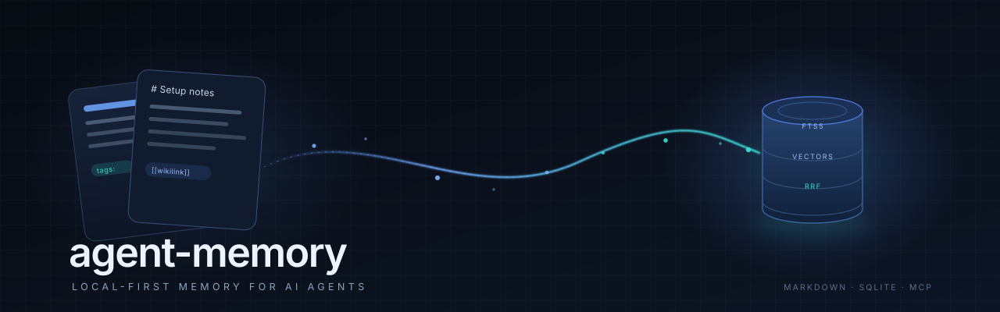
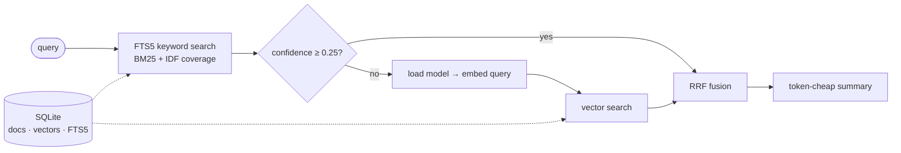

<p align="center">
  
</p>

<h1 align="center">agent-memory</h1>

<p align="center">
  <strong>Local-first memory for AI agents.</strong><br>
  Markdown notes in. Hybrid search out. Zero idle VRAM.
</p>

<p align="center">
  <a href="https://github.com/aqa03009-ux/agent-memory/actions/workflows/ci.yml"></a>
  
  
  
  
  
</p>

<p align="center">
  <a href="#why">Why</a> ·
  <a href="#how-it-works">How it works</a> ·
  <a href="#quick-start">Quick start</a> ·
  <a href="#usage">Usage</a> ·
  <a href="#mcp-server">MCP</a> ·
  <a href="#configuration">Configuration</a> ·
  <a href="#design-notes">Design notes</a>
</p>

> **The idea:** your notes are the database. The index is disposable. The
> embedding model is loaded on demand and released, not a resident service.

---

## Why

Agent memory usually fails in one of three ways:

| Problem | What it looks like | agent-memory |
|---|---|---|
| **Opaque** | Notes live in a vector DB you cannot read or diff | Markdown is the source of truth |
| **Expensive** | A model sits in VRAM all day, competing with real work | Model loads per command, exits after |
| **Noisy** | Every transcript and log gets embedded | `.memoryignore` keeps raw corpora out |

### How it compares

| | `grep` | Cloud vector DB | **agent-memory** |
|---|---|---|---|
| Source of truth | files | opaque index | **Markdown** |
| Idle cost | 0 | service + storage | **0 — model unloaded** |
| Semantic search | ✗ | ✓ | **✓ on demand** |
| Works offline | ✓ | ✗ | **✓** |
| Setup | none | account + SDK | **one script** |
| Human-editable | ✓ | ✗ | **✓** |

## Highlights

| | Feature | What it means |
|---|---|---|
| 🧠 | **Hybrid retrieval** | FTS5 BM25 + vectors, fused with Reciprocal Rank Fusion |
| 🪶 | **Token-cheap output** | Snippet + section headings by default; full text on request |
| 🔋 | **Zero idle cost** | The model is loaded per command and dies with the process |
| ⚡ | **Keyword fast path** | Confident keyword hits never open the model (~0.01 s) |
| 🔁 | **Incremental** | Only changed files are embedded; a no-op run opens nothing |
| 🧱 | **Crash-resistant** | OOM halves the batch instead of failing the reindex |
| 🕸️ | **Link graph** | `[[wikilinks]]` and `#tags` become `relations.md` |
| 📥 | **Session handoffs** | `open` / `claim` give agents a claim-once work queue |
| 🔌 | **MCP server** | 8 tools over stdio, JSON-RPC 2.0, no SDK |
| 🖼️ | **Optional media** | Images, audio, and video with a multimodal encoder |

## How it works



1. **Keyword stream.** Query tokens are stopword-filtered; tokens of 4+
   characters get prefix matching. BM25 ranks the candidates.
2. **Confidence gate.** IDF-weighted coverage measures how much of the query
   the best document actually contains. At `≥ 0.25` the keyword stream is
   trusted and the model is never opened. `--semantic` bypasses the gate.
3. **Semantic stream.** Notes are embedded once and cached as raw float32
   blobs; the query is embedded with the model's instruction prefix.
4. **Fusion.** RRF (`k = 60`) merges both rankings without comparable scores.

That is why a typical lookup returns in **~0.01–0.2 s** and costs **no VRAM**.

## Quick start

```bash
git clone https://github.com/aqa03009-ux/agent-memory.git
cd agent-memory

python3 -m venv .venv
source .venv/bin/activate
pip install -r requirements.txt

export AGENT_MEMORY_VAULT="$PWD/examples/vault"
./memory.py reindex
./memory.py search "why is the model lazy loaded"
./memory.py status
```

The first `reindex` downloads the embedding model (~1.2 GB) and embeds the
notes. Later runs only touch changed files.

> If you have an accelerator, install its torch build **before**
> `pip install -r requirements.txt` (see the GPU / ROCm notes below). The
> default PyPI wheel can be a multi-gigabyte CUDA download even on CPU-only
> machines.

<details>
<summary><strong>GPU / ROCm notes</strong></summary>

The default device is **CPU** on purpose. On the machine this was extracted
from, the ROCm path with bf16 produced NaN vectors; float32 was clean but cost
~2.5 GB of VRAM on every invocation. CPU float32 is the safe default for a
0.6B model.

```bash
AGENT_MEMORY_DEVICE=auto ./memory.py reindex   # try CUDA/ROCm, fall back to CPU
AGENT_MEMORY_DEVICE=cpu  ./memory.py reindex   # force CPU (default)
```

For ROCm, install the matching torch build first, then
`pip install -r requirements.txt`.

</details>

## Usage

| Command | What it does |
|---|---|
| `memory.py reindex` | Scan the vault, embed new/changed notes |
| `memory.py reindex --force` | Rebuild the whole index |
| `memory.py reindex --dim 512` | Change the MRL dimension (forces a full rebuild) |
| `memory.py reindex --with-images` | Also embed `assets/images/*` |
| `memory.py reindex --with-audio` / `--with-video` | Media embeddings (needs a multimodal model) |
| `memory.py search "query"` | Hybrid search, token-cheap summary |
| `memory.py search "query" --full --top 5` | Full text, five results |
| `memory.py search "query" --semantic` | Force semantic retrieval |
| `memory.py search "query" --fts` | Keyword only; never opens the model |
| `memory.py show setups/example-setup.md` | Print a note |
| `memory.py list --tag setup` | List notes by tag |
| `memory.py add --title "..." --tags "..." --file note.md --to decisions` | Add a note |
| `memory.py graph` | Write `relations.md` from links and tags |
| `memory.py assets` | Inventory media under `assets/` |
| `memory.py status` | Index, model, and resource status |
| `memory.py last --n 3` | Newest session handoff notes |
| `memory.py open` | Unclaimed handoff notes |
| `memory.py claim sessions/<file>` | Take a handoff note (claim-once) |
| `memory.py mcp` | Run the stdio MCP server |

### Vault layout

```text
vault/
├── 00-index.md          # entry point / map
├── profile.md           # canonical facts about the user
├── setups/              # how working things are configured
├── decisions/           # why something was chosen
├── projects/            # one note per project
├── research/            # deep-dive reports
├── sessions/            # session handoffs (open/claim queue)
├── daily/               # quick notes
├── assets/              # media (optional)
├── relations.md         # generated link graph
├── .memoryignore        # paths excluded from the index
└── .vectors/memory.db   # derived index (git-ignored)
```

Copy `.memoryignore.example` to `.memoryignore` when you want to exclude raw
corpora (transcripts, logs) from retrieval.

Every note is plain Markdown:

```markdown
# Local search setup

tags: #setup #search #local

Details here. Link related notes with [[decisions/example-decision]].
```

## MCP server

`memory.py mcp` speaks JSON-RPC 2.0 over stdin/stdout and exposes eight tools:

| Tool | Purpose |
|---|---|
| `memory_search` | Hybrid search with token-cheap summaries |
| `memory_show` | Full note by path |
| `memory_list` | List notes, optionally by tag |
| `memory_add` | Write a note and refresh the index |
| `memory_last` | Newest handoff note |
| `memory_open` | Unclaimed handoff notes |
| `memory_claim` | Claim a handoff note |
| `memory_status` | Vault / index / model status |

<details>
<summary><strong>OpenCode</strong></summary>

```json
{
  "mcp": {
    "memory": {
      "type": "local",
      "command": [
        "/absolute/path/to/.venv/bin/python",
        "/absolute/path/to/memory.py",
        "mcp"
      ],
      "environment": {
        "AGENT_MEMORY_VAULT": "/home/you/memory"
      },
      "enabled": true
    }
  }
}
```

</details>

<details>
<summary><strong>Claude Desktop</strong></summary>

```json
{
  "mcpServers": {
    "memory": {
      "command": "/absolute/path/to/.venv/bin/python",
      "args": ["/absolute/path/to/memory.py", "mcp"],
      "env": { "AGENT_MEMORY_VAULT": "/home/you/memory" }
    }
  }
}
```

</details>

The model is loaded inside the tool call and unloaded when the call ends, so an
idle MCP server holds no model in memory. Set `AGENT_MEMORY_MCP_KEEP_WARM=1` if
you prefer to keep it warm between calls.

## Session handoffs

`memory.py open` lists handoff notes that are still unclaimed.
`memory.py claim` rewrites the note's `status:` line to
`claimed (<timestamp>)`, so two agents never pick up the same task. Notes using
the original Turkish marker (`durum: devralındı` or `devralindi`) are also
recognized.

```markdown
# Finish the index migration

status: open
recorded: 2026-01-01 10:00
session: abc123

## What the user asked
...

## Where we stopped
...
```

## Configuration

| Variable | Default | Purpose |
|---|---|---|
| `AGENT_MEMORY_VAULT` | `~/memory` | Vault root |
| `AGENT_MEMORY_DB` | `$VAULT/.vectors/memory.db` | SQLite index |
| `AGENT_MEMORY_MODEL` | `Qwen/Qwen3-Embedding-0.6B` | Sentence-transformers model |
| `AGENT_MEMORY_DIM` | `256` | MRL truncation dimension |
| `AGENT_MEMORY_DEVICE` | `cpu` | A torch device (`cpu`, `cuda:1`, `mps`) or `auto` |
| `AGENT_MEMORY_QUERY_INSTRUCT` | Qwen3 instruction | Query-side prefix (applied when the model id contains `qwen`) |
| `AGENT_MEMORY_CHUNK` | `16` | Documents per embedding slice |
| `AGENT_MEMORY_BATCH` | `8` | Batch size inside a slice |
| `AGENT_MEMORY_MCP_KEEP_WARM` | `0` | `1` keeps the model loaded between MCP tool calls |

Using a different model? Set `AGENT_MEMORY_MODEL` and clear
`AGENT_MEMORY_QUERY_INSTRUCT` if it does not use query instructions. Changing
the model or dimension automatically forces a full reindex, because old
vectors live in a different space.

## Design notes

- **Incremental by mtime + identity.** Reindex compares file mtime and checks
  that a vector exists; it also stores model/dim metadata and rebuilds when
  they change.
- **Derived data is disposable.** `.vectors/` is git-ignored. Delete it and
  reindex; the Markdown never depends on the database.
- **Honest failure.** If the model is unavailable, the index keeps working in
  keyword mode. If a vector is stale, it is dropped rather than silently kept.
- **One reindex at a time.** A `flock` on `reindex.lock` prevents
  plugin-triggered background runs from stepping on each other.
- **All vault paths are contained.** `show`, `add`, and `claim` resolve their
  arguments and reject absolute paths or `..` traversal, so a prompt-injected
  note cannot turn an MCP tool into an arbitrary file read or write.
- **Long notes are indexed in full.** Embeddings cover the first 4,000
  characters, which is deliberate for note-sized documents; for books, split
  them into notes.

## Limitations

- Single-user, local, no authentication. Do not expose the MCP server over a
  network.
- FTS5 requires a Python build of SQLite with FTS5 enabled (most Linux distros
  are fine).
- Media embeddings need a multimodal model (e.g. `google/embeddinggemma-2`)
  plus `pillow`, `soundfile`, `librosa`, and `ffmpeg`. The text path does not.
  Text and media share one vector space, so switching models requires a full
  reindex.
- Tested on Linux with Python 3.11 and 3.12 (CI runs 3.12), using
  Qwen3-Embedding-0.6B. The design is model-agnostic, but the MRL and
  instruction defaults are Qwen-specific.

## License

MIT — see [LICENSE](LICENSE).

<p align="center">
  <sub>Built for agents that live on one machine.</sub>
</p>
